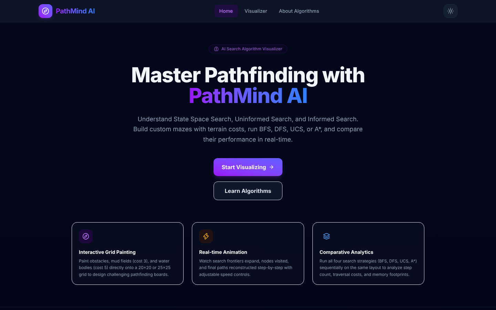
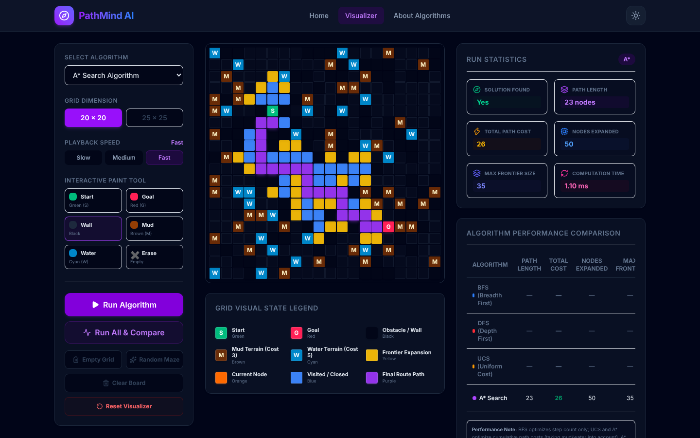
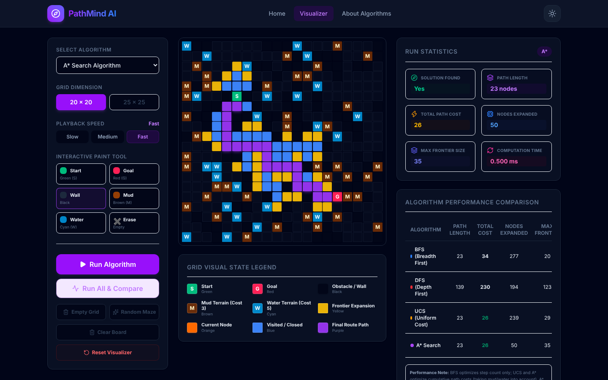
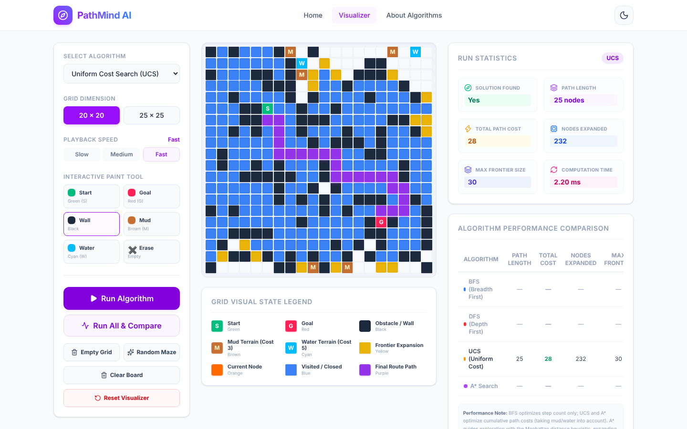
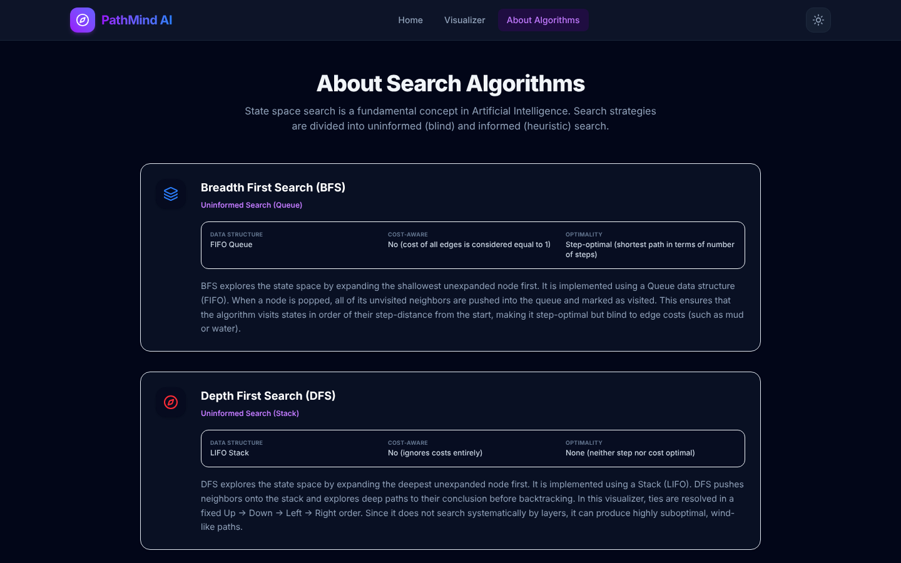

<div align="center">

# PathMind AI

**An interactive visualizer for AI search algorithms — BFS, DFS, UCS and A\***

*Visualize. Explore. Compare.*

[](https://react.dev)
[](https://www.typescriptlang.org)
[](https://vite.dev)
[](https://tailwindcss.com)
[](./LICENSE)

[**Live Demo**](https://path-mind-ai-pi.vercel.app/) · [Getting Started](#getting-started) · [How to Use](#how-to-use) · [Algorithms](#the-algorithms)



</div>

---

## About

Search algorithms are usually taught on paper, where you only see the final path. You don't see *how* the algorithm got there — which cells it looked at, in what order, and why.

PathMind AI makes that process visible. You draw a grid (or generate a random maze), pick an algorithm, and watch it explore step by step. Then you can run all four algorithms on the same grid and compare their results side by side.

It was built as a case study for an undergraduate Artificial Intelligence course on **uninformed** and **informed** search.

> **Note:** PathMind AI is purely algorithmic. There is no training data and no machine-learning model — the grid you draw *is* the input, and every run is deterministic.

---

## Features

| Feature | What it does |
|---|---|
| **Paintable grid** | 20×20 or 25×25 grid. Click or drag to place start, goal, walls, mud and water. |
| **Terrain costs** | Normal = 1, Mud = 3, Water = 5, Wall = impassable. Shows the difference between "fewest steps" and "cheapest path". |
| **Step-by-step animation** | Watch the frontier grow, the current node being expanded, visited cells and the final path — at slow, medium or fast speed. |
| **Live statistics** | Solution found, path length, total cost, nodes expanded, max frontier size and computation time. |
| **Run All & Compare** | Runs BFS, DFS, UCS and A\* on the same grid and fills a comparison table. |
| **Random maze** | Generates a maze with walls and terrain that is always solvable. |
| **Light & dark theme** | Toggle from the header; your choice is remembered. |
| **Theory panel** | Explains the selected algorithm, its data structure, and its pros and cons. |

---

## Screenshots

### A\* finding a path through a random maze
Purple is the final path, blue cells were visited, yellow cells are still on the frontier.



### Run All & Compare
All four algorithms run on the same grid. UCS and A\* find the same lowest cost (26), but A\* expands far fewer nodes (50 vs 239). DFS finds a path, but a very long and expensive one.



### Light mode — Uniform Cost Search



### About Algorithms page



---

## Getting Started

### Prerequisites

You need **Node.js 18 or later** (Node 20+ recommended), which includes `npm`.
Check what you have installed:

```bash
node -v
npm -v
```

If Node is missing, download it from [nodejs.org](https://nodejs.org/).

### 1. Get the code

Clone the repository (replace the URL with your own repository link), or download and unzip the project folder:

```bash
git clone <repository-url> PathMind-AI
cd PathMind-AI
```

### 2. Install dependencies

```bash
npm install
```

### 3. Start the app

```bash
npm run dev
```

Open **http://localhost:5173** in your browser. The page reloads automatically when you change the code.

### 4. (Optional) Build for production

```bash
npm run build     # type-checks and builds into the dist/ folder
npm run preview   # serves the built version locally to check it
```

The `dist/` folder is a static site — you can host it on Vercel, Netlify, GitHub Pages or any static host.

### Available commands

| Command | What it does |
|---|---|
| `npm run dev` | Starts the development server |
| `npm run build` | Type-checks the code and creates a production build in `dist/` |
| `npm run preview` | Serves the production build locally |
| `npm test` | Runs the algorithm unit tests (Vitest) |
| `npm run lint` | Checks the code for common problems (Oxlint) |

---

## How to Use

1. **Open the Visualizer** — click **Start Visualizing** on the home page, or **Visualizer** in the top bar.
2. **Build a grid** — either click **Random Maze**, or paint your own using the tools in the left panel:

   | Tool | How to use | Appears as |
   |---|---|---|
   | Start | Click a cell to move the start point | Green **S** |
   | Goal | Click a cell to move the goal | Red **G** |
   | Wall | Click or drag — cannot be crossed | Black |
   | Mud | Click or drag — costs 3 to enter | Brown **M** |
   | Water | Click or drag — costs 5 to enter | Cyan **W** |
   | Erase | Click or drag to clear a cell | Empty |

   Tip: hold the mouse button down and drag to paint many cells quickly.

3. **Pick an algorithm** from the *Select Algorithm* dropdown, and a **playback speed** (Slow / Medium / Fast).
4. **Click Run Algorithm** and watch the search. The *Run Statistics* panel fills in when it finishes.
5. **Click Run All & Compare** to run all four algorithms on the same grid and see the comparison table.
6. **Start over** when you're done:
   - **Clear Board** / **Empty Grid** — remove all walls and terrain, but keep your start and goal where they are
   - **Reset Visualizer** — resets everything: blank grid, start and goal back to their default positions, results cleared

### What the colours mean

| Colour | Meaning |
|---|---|
| Yellow | **Frontier** — cells waiting to be explored |
| Orange | **Current** — the cell being expanded right now |
| Blue | **Visited** — cells already explored |
| Purple | **Final path** — the route from start to goal |

---

## The Algorithms

Every algorithm keeps a **frontier** — a list of cells it has discovered but not yet explored. The only real difference between them is *which cell they pick next*.

| | BFS | DFS | UCS | A\* |
|---|:---:|:---:|:---:|:---:|
| **Type** | Uninformed | Uninformed | Uninformed | Informed |
| **Picks next** | Oldest cell (queue) | Newest cell (stack) | Cheapest so far | Cheapest so far + estimate to goal |
| **Considers terrain cost?** | No | No | Yes | Yes |
| **Fewest steps guaranteed?** | Yes | No | No | No |
| **Lowest cost guaranteed?** | No | No | Yes | Yes |
| **Typical nodes explored** | Many | Varies | Many | Fewest |

- **BFS (Breadth-First Search)** explores in rings outward from the start. It finds the path with the fewest steps, but happily walks through expensive water.
- **DFS (Depth-First Search)** goes as deep as it can in one direction before backtracking. It finds *a* path, but often a long, winding one.
- **UCS (Uniform Cost Search)** always expands the cell that is cheapest to reach so far. It finds the lowest-cost path, but searches in every direction.
- **A\* Search** works like UCS but adds an estimate of the remaining distance to the goal, so it heads toward the goal and explores far fewer cells.

### The A\* formula

```
f(n) = g(n) + h(n)
```

- **g(n)** — the actual cost to get from the start to cell *n*
- **h(n)** — an estimate of the cost from *n* to the goal. PathMind uses the **Manhattan distance**: `|row₁ − row₂| + |col₁ − col₂|` (the number of steps if there were no obstacles)

Because every move costs at least 1 and you can only move up, down, left or right, the Manhattan distance never overestimates the true cost. That is why A\* is guaranteed to find the lowest-cost path here.

---

## Project Structure

```
PathMind-AI/
├── public/                 Favicon and static icons
├── docs/images/            Screenshots used in this README
├── src/
│   ├── algorithms/         BFS, DFS, UCS, A*, heuristics + unit tests
│   ├── app/                Pages: Home, Visualizer, About, 404
│   ├── components/
│   │   ├── controls/       Left sidebar (algorithm, speed, tools, buttons)
│   │   ├── grid/           Grid and cell rendering
│   │   ├── panels/         Statistics, comparison table, theory panel
│   │   ├── layout/         Header and footer
│   │   └── shared/         Colour legend
│   ├── hooks/              Grid state, algorithm runner, animation player, maze generator
│   ├── lib/                Maze generator and path reconstruction
│   ├── constants/          Terrain costs, colours, grid defaults
│   ├── types/              TypeScript types
│   └── utils/              Neighbour lookup, time formatting
├── ARCHITECTURE.md         Detailed design notes
├── package.json
└── vite.config.ts
```

### How it works (in short)

1. When you click **Run**, the chosen algorithm runs **instantly** on the grid and records every step it takes (frontier → current → visited → path) in a list.
2. The animation player then **replays that list** at the speed you chose.

Because the calculation finishes before the animation starts, the reported computation time is the real algorithm time — changing the speed does not affect it. See [`ARCHITECTURE.md`](./ARCHITECTURE.md) for more detail.

---

## Tech Stack

- **React 19** + **TypeScript** — user interface
- **Vite** — development server and build tool
- **Tailwind CSS 4** — styling
- **Framer Motion** — animations
- **Lucide React** — icons
- **Vitest** — unit tests

All search algorithms are written by hand — no pathfinding libraries are used. Everything runs in the browser; there is no backend.

---

## Limitations & Future Scope

**Current limitations**
- Covers four classical algorithms only (BFS, DFS, UCS, A\*)
- Grid-based, four-direction movement only (no diagonal moves or general graphs)
- Performance numbers are meant for learning, not for large-scale benchmarking

**Possible future additions**
- More algorithms: Bidirectional BFS, Dijkstra's algorithm, Greedy Best-First Search
- Custom terrain costs
- Import / export of mazes
- Step backward and replay controls

---

## References

1. Russell, S. & Norvig, P. — *Artificial Intelligence: A Modern Approach*, 3rd Edition, Prentice Hall
2. [React documentation](https://react.dev)
3. [TypeScript documentation](https://www.typescriptlang.org/docs/)
4. [Vite documentation](https://vite.dev)
5. [Tailwind CSS documentation](https://tailwindcss.com/docs)

---

## License

Released under the [MIT License](./LICENSE).
